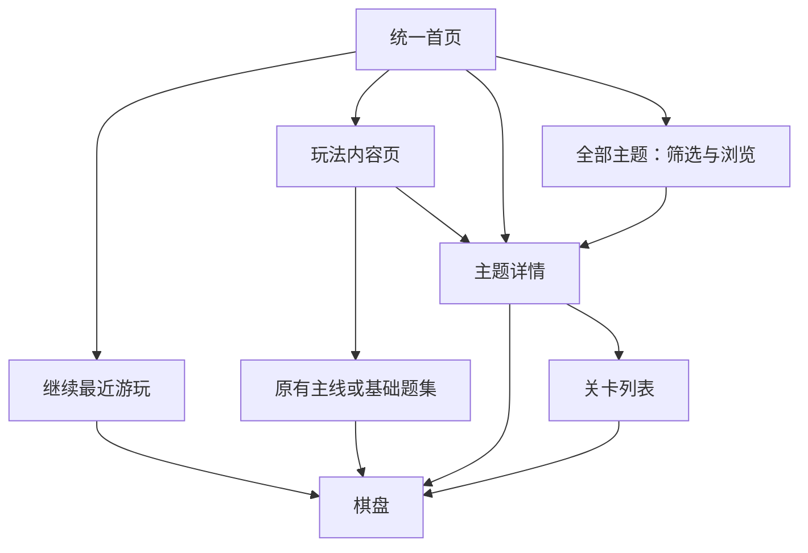

# 首页与主题浏览方案

整理日期：2026 年 10 月 12 日。本文是后续首页信息架构、主题展示与浏览流程的唯一责任文档。

**已选方向**：用户偏好“继续优先”的排版，并从首页创意中选择“主题画廊”作为细化基础。**本轮方案**：以继续入口、玩法入口和主题画廊组成统一首页；主题增多后进入独立主题库浏览。具体布局、筛选、卡片和详情流程仍为待评审草案，不代表授权开发或已交付。

当前应用首页只有经典排序与颜色记忆两个入口，实际行为见[当前基线](current-baseline.md)和[游玩流程](play-flow.md)。球排序、主题题集及本方案的新首页均未实现。本轮只讨论整体架构和界面，不安排题库生产、玩法细则、背景素材或收费实现。

## 内容如何组织

采用“玩法 → 内容集合 → 关卡”的结构。玩法说明怎么玩，内容集合说明这次想玩什么，关卡承担具体题目与进度。

| 层级 | 界面含义 | 本轮边界 |
| --- | --- | --- |
| 玩法 | 倒水排序、球排序、颜色记忆 | 三入口是未来首页草案；球排序仍是待评审扩展 |
| 内容集合 | 原有主线／记忆题集，以及未来的主题题集 | 主题可按轻松、适中、挑战等体验组织，配合相应背景 |
| 关卡 | 集合中的题目、当前进度和已完成重玩 | 访问资格与通关进度分别表达，购买不等于完成 |

每个主题先归属一种玩法，首页主题画廊可展示不同玩法的主题，主题卡明确标出玩法。未来是否做跨玩法合集另行讨论。钥匙、盖布和逐层显色继续属于经典排序的关卡能力，不增加“揭秘模式”、独立入口或另一套进度，规则由[经典扩展](color-unlock-plan.md)负责。

## 首页：继续优先，画廊承担探索

手机纵向草案由上到下如下：

```text
游戏标识                         设置

继续游玩
最近玩的集合 · 玩法 · 当前关卡
                           [继续]

[倒水排序]   [球排序]   [颜色记忆]

主题画廊                     全部主题 →
[大幅主题封面、名称、体验、状态]
[大幅主题封面、名称、体验、状态]

外观入口／轻量 Premium 说明
```

继续卡放在首屏，直接恢复最近一次实际游玩的内容，显示玩法、集合与关卡，避免只写“继续”而不知道会回到哪里。首次游玩时提供明确的开始入口；没有未完成棋盘时显示适合继续推进的内容，不伪造存档。

三个玩法入口保持紧凑，使熟悉玩法的玩家可以直接进入。主题画廊采用横向大封面卡片、纵向排列，以背景气氛形成首页的主要视觉特色；继续卡与玩法入口不被画廊挤出首屏。

首页建议只精选 2–3 个主题，并提供“全部主题”。这是排版建议，不是固定主题数量或自动推荐机制。主题增加后，首页仍保持短而清楚，完整内容交给主题库。精选顺序先按清晰的内容编排处理，个性化推荐不在本轮方案中。

设置保持全局入口；现有十五款器皿继续免费选择并记住。外观入口的具体位置与交互待细化。Premium 以轻量说明和内容详情中的相关入口呈现，首页不另建一块重复列举内容的“付费游戏区”。

## 主题多了：主题库负责查找

“全部主题”进入独立主题库。当前草案提供两个筛选维度：

- 玩法：全部、倒水排序、球排序、颜色记忆。
- 体验：全部、轻松、适中、挑战。

两个维度可以组合，空结果有清楚的提示与重置入口。“轻松／适中／挑战”是面向玩家的体验描述，具体判定须后续校准，不能直接把现有离线分数当作玩家认可的等级。

主题库以双列封面卡为默认讨论稿，也保留横向列表供比较；最终形式待确认。卡片包含封面、主题名、玩法、体验标签，以及一种主要状态，例如“可免费体验”或“已开始”。已开始的主题可附简短进度。收费范围须清楚，但不让锁图标或购买按钮压过内容本身。

草图采用分页控制长列表；未来也可比较连续滚动。返回主题库时保留筛选、展示形式与所在页／滚动位置，使玩家可以接着浏览。搜索入口是否需要，待实际主题规模明确后再决定。

会话草图中的 12 个主题、每页 4 个主题、示例名称和进度都只用于观察布局，不构成题库数量、发布批次或品牌命名决定。

## 点进去：先了解主题，再开始游玩

主题详情按以下顺序呈现：大幅气氛封面、主题名、玩法与体验标签、一句内容说明、主要行动、题目浏览和次要权益说明。

| 玩家状态 | 主要行动草案 | 辅助信息 |
| --- | --- | --- |
| 尚未开始且可体验 | 开始免费体验 | 清楚显示该主题实际开放的体验范围 |
| 已经开始 | 继续游玩 | 显示当前关卡与进度，可另行浏览题目 |
| 已有完整访问资格 | 开始／继续 | 按该集合自己的推进规则进入 |
| 体验结束且后续需 Premium | 查看 Premium 权益 | 说明将获得哪些内容，保留已完成题目的重玩入口 |

最后一行仅说明未来主题若采用该收费方案时的界面承接，不批准新的付费边界。详情页可以直接开始或继续，关卡列表作为可选入口；玩家不必每次先经过题目列表。列表区分已完成、当前可玩、尚未按序开放和需要访问资格的内容，不能用一种锁状态混淆这些原因。

从首页进入某种玩法时，先到该玩法的内容页：原有主线／基础题集在前，相关主题在后。它与“全部主题”的差别是先聚焦玩法，避免原有经典千关和记忆百题被淹没在主题封面中。



浏览返回原来的来源页；从主题详情返回主题库时保留浏览位置。棋盘退出返回所属内容，首页继续卡随实际游玩更新，而不是随浏览封面更新。

## 视觉与恢复边界

首页与主题库共用安静、清楚的基础界面，把主题差异集中在封面与详情背景。轻松主题可用明亮、舒缓的气氛，挑战主题可用深色、克制的气氛；具体画风、背景和主题名仍待选择。不能只依赖背景颜色区分玩法或难度，文字标签始终可辨。

主题封面用于表达内容气氛，棋盘继续以颜色辨认和操作清晰为先。会话草图中的瓶、球和背景只是布局示意，不能替代已批准的玻璃外观，也不是球排序正式素材。

统一继续入口只负责导航，各玩法和集合保留自己的棋盘与进度。以后实现时必须保护现有 SQLite 进度、钱包、偏好、身份和统计，不能用一个全局“最近玩过”记录覆盖所有存档；已完成重玩不覆盖待解关卡，也不重复授予奖励。保存机制由[系统架构](system-design.md)与[统计存储](gameplay-statistics-plan.md)维护，本轮不设计新表或迁移。

## 后续需要确认的事项

下一轮优先确认首页各区域的比例、主题库采用双列还是列表、分页还是连续浏览，以及玩法内容页与主题详情的信息量。之后再讨论轻松／挑战题目的设计、背景制作与内容规模。

免费体验给五题、五十／六十题，或采用其他数量，尚未决定；草图中的体验关卡按钮也不是承诺。经典千关长期免费是否替代既有 100 关／推荐方案，仍待明确。商业规则、No Ads 承诺、记忆扩展与候选价格统一由[商业规则与创意](gameplay-ideas.md)维护，不因首页方案变更；球排序的动作规则与题库也留在该文档的创意 158，后续单独评审。
