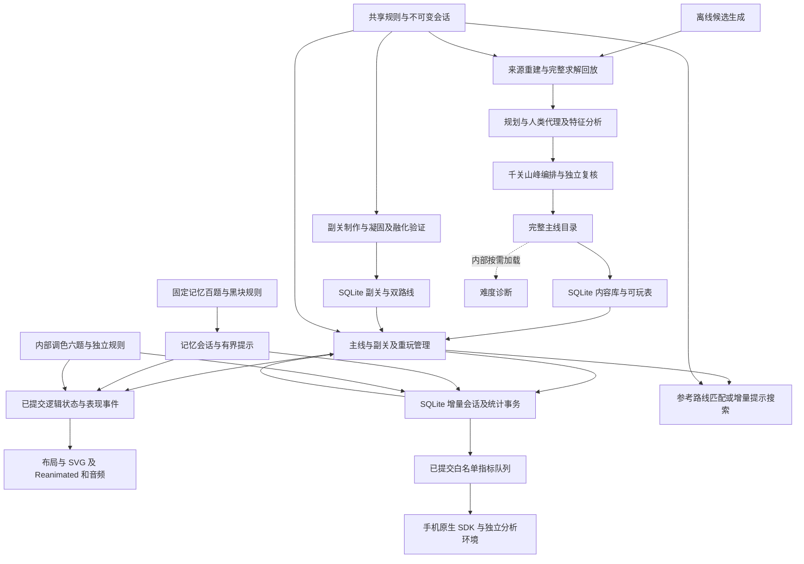

# Bottle Harmony 系统架构与引擎升级方向

更新日期：2026 年 10 月 10 日。本文描述当前源码架构、已实现的可扩展排序引擎及分阶段验收边界。应用已进入 Google Play 封闭测试，状态见[发布记录](release-readiness.md)；功能与版本总览见[实现基线](current-baseline.md)，逐项玩家行为见[游玩流程](play-flow.md)。产品方案与候选见[产品规则与创意](gameplay-ideas.md)。

## 数据流与职责



离线生产负责证明内容可解、重现来源和统一评价；设备读取已验收资产，不现场生产或完整评级。普通规则和凝固规则由游戏、求解及回放共同使用。渲染、存储和联网不参与规则判定。

## 核心与制作模块

| 模块 | 当前职责 |
| --- | --- |
| `src/game/model.ts`、`codec.ts` | 稳定关卡／瓶子／颜色 ID、统一容量、严格输入校验、实际布局编码 |
| `rules.ts`、`solidRules.ts` | 最大连续同色倒水、完成与合法移动；副关底层凝固限制 |
| `session.ts` | 经典 v1 适配到共享单位内核，保持旧会话／历史、融化与原备用瓶行为 |
| `engineModel.ts`、`engine.ts`、`transfer.ts` | 独立容器、单位转移、目标、机关、知识与有界会话；纯 TypeScript |
| `engineSearch.ts`、`engineBenchmark.ts` | 通用规则的分片证明／回放、保守一步提示及共享 CPU 工作负载 |
| `solver.ts`、`solverAStar.ts` | 分段、有预算 BFS／A*、取消、最短路线和完整无解；未知不升级成结论 |
| `generation.ts`、`generator.ts`、`contentCodec.ts` | 确定来源候选、结构去重、生成预算及完整回放 |
| `difficulty.ts`、`difficultyLoad.ts`、`humanDifficulty.ts` | 旧规划证据与当前 0–100 人类决策代理；离线执行 |
| `levelFeatures.ts`、`featureDistribution.ts` | 结构事实、路线观察与精确分支标签及统计 |
| `productionPlan.ts`、`waveSelection.ts` | 50 个二十关周期、次峰／主峰和回落约束、候选分配 |
| `mainlineCatalog.ts`、`mainlinePlayable.ts`、`solidSide.ts` | 完整目录、严格投影与副关资产载入 |
| `memory.ts`、`memorySolver.ts`、`memoryRoutes.ts` | 稳定单位、黑色兼容规则、自动揭晓、路线映射与有界提示 |
| `memoryDifficulty.ts`、`memoryRatingSearch.ts` | 记忆双轴离线评级；不在手机运行 |
| `mixing.ts`、`mixingCatalog.ts` | 内部六题、两份配方、自动交付与整步撤销 |

主线生产内容最多 11 色／12 瓶、四层；旧统一容量编码保护上限 12 色／16 瓶／容量 8；新引擎另支持独立容量至 16，产品布局仍最多十二瓶。生成器支持全打乱、一层底色混排及旧来源重建，现行千关不采用双层固定底色。制作契约见[生成](generation.md)与[配方](production-plan.md)。

`assets/levels/mainline-catalog.json` 保留完整来源与评级证据，`mainline-play.json` 是离线一致性投影；`content.sqlite` 才是随包运行关卡库，启动只读清单，布局、路线及诊断按需查询。`solid-side-50.json` 保存副关双状态路线及单独风险证据，不能套用主线难度分。80 题旧池及 `play.ts`／`playCodec.ts` 保留作工具和回归，公开入口使用 `mainline.ts`。

## 进度与保存

记忆玩法由 `game/memory.ts` 保存稳定液体单位、GameSession 兼容快照与固定遮色；黑块兼容／一次一份和公开终局自动揭晓由独立记忆规则判定，不能直接调用普通同色规则代替。观察／整理／查看与答错后的显色整理分开，揭晓后知识不回退。`MemoryScreen.tsx` 复用原有玻璃、布局、倒水、水声与完成表现。`memoryRepository.ts` 使用同一玩家库和修订队列，增量保存单位快照／知识、独立尝试及辅助事实；不改变主线状态或钱包。具体契约与百题制作见[记忆专题](memory-mode-plan.md)。内部调色由 MixingRepository 保存独立会话／交付及最近 256 步历史，仅内部构建初始化，见[调色实现](mixing-mode.md)。

`mainline.ts` 管理主线、当前副关和已完成关卡的独立重玩。合法倒水先更新会话，立即记录首次完成、提示奖励及副关完成位置；继续操作再切入对应副关或下一主线。第 1000 题后完成副关 50 即结束。重玩和内部预览不推进待完成的主线。

`src/storage/runtime.ts` 初始化两个 SQLite 库；`contentRepository.ts` 按需构造独立核心模型，布局最多缓存 32 关。`playerRepository.ts` 串行事务提交修订、恢复快照、偏好、统计及去重边界；`sessionStorage.ts` 增量追加撤销快照并恢复时校验，`statistics.ts` 维护挑战、尝试、摘要与有界事实。`usePlayProgress.ts` 连接已接受动作和页面／生命周期，单调计时每十秒及动作边界保存，不按帧写库。数据库事务不包含求解和表现。

声音、符号、容器和显式语言选择均在玩家库；选择跟随系统时保存 system，具体系统语言在运行时读取。初始化只对真正空的新库执行一次；错误保留已有库并显示重试。SQLite 基线建立时未继承旧开发存档；闭测已开始，后续更新必须保留现有玩家数据，错误不得触发清库或覆盖。旧 codec 与 writer 只用于离线回归，不参与新版运行保存，没有 AsyncStorage 依赖、双写、导入或回退。product-metrics-v1 在同一事务维护首次事实、时间切片、长期摘要与有界上传队列；src/analytics/ 在提交后异步发送。手机／平板按保存偏好配置原生 SDK，默认新安装开启；Production／Test 分开，Web／TV 离线。没有账号或云存档同步。统计、采集与新基线边界见[统计专题](gameplay-statistics-plan.md)。

## 界面、输入与表现

`App.tsx` 提供安全区域及语言上下文，`DemoScreen.tsx` 虽沿用旧文件名，实际已承载主页／游戏切换、主线与副关、输入、提示、表现及菜单协调。`HomeScreen.tsx` 和 `VesselCarousel.tsx` 负责经典／记忆入口及十五款外观；`MainlineMenu.tsx` 负责虚拟选关、重玩和设置，内部入口受构建配置控制。

`boardLayout.ts` 保留 4–12 瓶统一尺寸、两排最多六列；`deviceLayout.ts` 选择底栏／侧栏及 TV 安全区；`boardNavigation.ts`、`useBoardKeyboard.ts` 与 `FocusablePressable.tsx` 提供键盘／遥控焦点。窗口变化重排显示并取消当前视觉动作，保持已提交液体和进度。实际平台证据见[设备支持](device-support.md)。

`src/art/` 根据各容器真实腔体、瓶口和倾角呈现液体与水流；高脚杯杯脚不盛水。SVG 绘图、点击区域和逻辑瓶子身份分开，切关复用绘图槽位。倒水允许横向越界裁切。完成瓶固定窄口瓶塞／宽口光晕，整局礼花在完成棋盘叠加，视觉结束后显示继续。

`PourSound.tsx` 保持当前音色类三段短播放器准备，出水时只选择已就绪片段；迟到和中途解除静音不补播。礼花声与倒水声共用本地开关。`gamePresentation.ts`、`pourSoundGate.ts` 及相关取消机制处理后台、窗口变化、撤销／重来和减少动态效果。详见[水声与表现](pour-presentation-design.md)。


## 核心接口与保护边界

`LevelDefinition` 保存规则、关卡 ID、统一容量、逻辑颜色目录和稳定瓶 ID；层数组从底到顶。颜色 ID 独立于 RGB，每色总层数等于容量。通用输入允许 2–16 瓶、1–12 色、容量 1–8，现行产品仍为四层、最多十二瓶／十一色。`decodeLevel` 严格检查唯一 ID、引用、守恒、格式和字段，JSON 至多 32768 字符；返回冻结副本，格式有效不代表可解。

`createSession` 复制并冻结输入；`moveSession` 返回新会话及前后棋盘、瓶 ID／索引、颜色和层数事件，拒绝时为 null。`undoSession`／`resetSession` 免费；无历史撤销保持原会话。`meltSession` 保留历史，撤销不 refreeze、重来 refreeze；`extendSessionWithEmptyBottle` 仅接回已验证的原末尾瓶并扩展撤销快照。单色满瓶不额外锁定，整关 solved 停止新倒水但允许撤销／重来；stalled 只表示当前无合法动作。

`createSolver(board, options)` 返回任务，`step(maxExpansions, sliceMilliseconds)` 分段推进，未完成为 null，`cancel()` 释放搜索；`solveBoard` 是离线同步包装。默认五色以内 BFS，更多颜色 A*，下界为颜色段数减颜色数。仅合并规则角色相同的瓶，未融化目标保留身份；实际路线保留真实索引并完整回放。

| 结果 | 契约 |
| --- | --- |
| solved | 最短合法路线，完整回放通过 |
| unsolvable | 完整搜索穷尽 |
| limitReached | 状态／活跃时间预算或取消，结论未知 |
| invalid | 输入或预算非法，附原因 |

默认 30000 状态／250 ms 活跃时间；统计访问、展开、转移、队列峰值与活跃耗时，暂停不计时。无独立精确字节预算，协作切片不是硬实时保证。参考路线提示须匹配实际棋盘；偏离后增量搜索，后台／卸载取消，失效结果不得倒水。

主线／副关／重玩各保留最近 4096 个撤销快照；超过上限用守恒校验的锚点继续存储，累计路线偏移独立保留。实际操作摘要不依赖撤销栈；原始统计按 30 天／5 万事件工程预算清理。SQLite 两库及 WAL 的字节、长历史恢复和写入延迟需分别测量，桌面结果不作为手机性能证据。
内部选题面板只在实际打开时挂载。清单筛选及卡片摘要只能访问预载的 `colorCount`／`bottleCount`／关号，不通过 `level` 惰性 getter 遍历题库；选中实际预览后才构造该局面。这样隐藏工具不触发同步数据库读取，也不挤掉正在玩的布局缓存。
瓶子 SVG 仅定义当前槽位实际使用的颜色渐变；接水／出水图形仅在对应动作挂载，瓶塞／光晕与完成图形在逻辑完成时提前挂载，仍由可见液量和原完成时钟控制显隐。未完成瓶不创建透明的完成子树，凝固几何只在实际凝固时计算。保留同尺寸玻璃、液体几何和原时间线；按需挂载不能成为逻辑提交或推进的条件。

## 可扩展排序引擎

**源码已实现，当前经典主线／副关已使用共享转移内核；新增机制只在内部验收页开放，正式题库保持不变。** 引擎搬运、归类和收集既有颜色，不执行混色。经典排序、记忆及内部调色保留各自公开语义；精选 Premium、球排序资源及二十／三十瓶布局仍是后续产品决定。

### 容器、转移与目标的具体边界

| 层次／源码 | 当前契约 |
| --- | --- |
| `engineModel.ts` | `SortingPuzzle` 严格新编码：`bottle-harmony-engine`／版本 1／`sorting-v1`；题目 ID、内容 revision、稳定液体份 ID、容器目录、固定初始状态、目标与机关 |
| 容器 | 独立 capacity、canSource、canReceive、receive（same／any）、acceptColors（显式可接颜色或 null）、fixed；protectedBottom 保留凝固底份。fixed 只限制表现，不暗中取消源权限；目标条件不隐式成为接收限制 |
| 单位／转移 | 从底到顶有序的稳定单位；`transfer.ts` 共用最大已知连续同色段／一次一份、容量、接收匹配、源／目标权限与保护底部检查。没有合成、销毁或真实流体计算 |
| 完成目标 | `sort` 指定集合内非空容器满且单色；`collect` 指定容器／颜色／数量，独立配置 exact 与 exclusive；`sequence` 完整匹配从底到顶层序；`all` 有限合取。局部目标可允许余料不整理，经典配置继续全盘整理 |
| 机关／信息 | empty 整瓶钥匙、color-full 四份同色盖布；固定解锁一瓶／一组；hidden 绑定单位身份，露顶自动显色。真实状态与已知信息分开 |
| `engine.ts` | 编译不可变运行定义、原子转换、可见投影、事件、会话修订、撤销／重来、严格恢复；无 React／Expo／SQLite／网络依赖 |
| `engineSearch.ts` | 同一转换的分片 BFS 证明、完整路线回放和保守安全一步提示；预算不足为 unknown |
| `sortingStorage.ts` | 使用现有串行事务队列保存新格式的当前状态和增量检查点；具体表与升级边界见[SQLite 责任文档](gameplay-statistics-plan.md#四-本地存储与事务) |
| `EnginePreview.tsx` | 内部五个固定验收场景，消费可见投影和已提交事件，复用玻璃／水流／声音／键盘操作；不保存、不解锁、不发券 |

新格式保护上限是 16 容器、每只 1–16 份、12 色、192 液体份、32 机关；JSON 至多 131072 字符，目标至多 32 节点／深度 4。未知字段、版本、策略、重复身份、无效引用、超容量和不足目标库存均拒绝。这是工程预算，不代表已验收十六瓶产品布局。现有水排序 v1 编码仍保持统一容量 1–8 的旧边界，经过 `classicSortingPuzzle` 规范化；不放宽旧解析器。

无新增机制的经典关卡继续使用 `GameSession` 外部契约、原来的进度／奖励／SQLite 格式和视觉时间线。其棋盘是新内核单位状态的只读颜色投影，运行缓存保存单位身份；旧库恢复先按原格式校验，再确定性分配无身份差异的同色单位。新增机制则必须使用精确单位检查点，不能经旧颜色存档丢失知识或机关。普通／凝固旧求解器保留已经验证的 BFS／A* 优化，通过相同 `transfer.ts` 数量与完成规则执行；新增目标和信息状态走通用求解器，不能套用旧瓶对称与启发式。记忆万能黑块和内部配方继续各自规则，不借此次升级改变语义。

### 原子动作与知识

一次 `transitionEngine` 先验证公开可操作条件，再转移单位；同步计算本步所有机关、公开信息及完成状态，返回不可变状态与 transfer／unlock／reveal／solved 事件。每轮同时开放符合条件的组，逐轮至稳定；每机关至多触发一次，因此至多机关数轮发生变化。无随机数、动画回调或数据库参与。

逐层显色**只倒原先已知的同色连续段，遇原隐藏边界即停止，即使真实同色；露顶显色后再次点击继续**。撤销回退液体／锁定／触发记录，保留本次尝试见过的单位及空瓶信息；重新锁定但已见瓶仍显示所知内容并禁止操作。重来恢复定义的初始遮盖／开放状态。知识随单位移动，不能按槽位记录。失效操作以会话 revision 拒绝；内部提示另外核对 attempt、完整定义 binding 和 revision，取消／切题后不应用旧结果。

`visibleEngineState` 对首次未开放瓶隐藏液体及填充量，公开位置、容器容量、锁与条件。渲染、读屏和提示不读取未知单位真实颜色。锁定瓶已知内容保持可见仍不可操作；见过的空瓶也不重新变成未知。表现可以延后至倒水回位才显露机关，但逻辑已提前提交；撤销、重来、返回、后台和尺寸变化取消表现，恢复已提交状态。

### 搜索、提示与恢复

通用证明 BFS 保留容器顺序，绝不将容量、权限或目标角色不同的容器作对称合并。状态键包含颜色排列、已知／隐藏行为、开放组和触发记录；仅同色且公开行为完全相同的单位可等价去重，节点仍保留真实 ID 用于路线回放。零启发式保证返回路线最短，穷尽才报告 unsolvable；默认 30000 状态、250 ms 活跃时间、32 MiB 估算分配预算，支持取消与协作切片。估算预算不是精确堆内存上限，GC 也可能超过切片目标。

真实布局完整解只证明可解，不证明隐藏信息公平。一步提示在全知局面证明后续可解；遮色普通四份库存则枚举所有公开信息相容的颜色分配，仅推荐在每种分配下仍保有解的动作。世界数量（默认 32）、时间或搜索耗尽返回 unknown；首次未见锁瓶的液量或非经典隐藏库存尚不枚举，诚实返回 information unknown。构造阶段也受短预算限制。这是保守的一步安全证据，不是整题自适应策略、所有分支或真人体验的证明；正式机关题须按[关卡质量方案](color-unlock-plan.md#出题与验证)单独验收。

`EngineSession` 绑定 attempt、单调 revision 与完整规范定义；每次成功动作只追加一个撤销检查点。最近历史同时受 4096 步和 8 MiB ASCII JSON 编码预算限制，裁剪后保留 offset 锚点。恢复验证字段、容量、单位唯一、逐色库存、底层保护、开放／机关关系、知识单调及每个保留动作；从变化的两只容器推导候选后用同一转换重放。`createEngineRestoreTask` 分片校验，SQLite 适配让出执行权；同步包装只用于离线工具／测试。原生适配通过 React Native scheduler 的低优先级任务交还执行权，让输入／渲染优先，保留 4 ms 计算分片；Node／浏览器使用同包各自的事件循环调度。裁剪锚点保证结构和保留路线有效，不声称重建已裁剪的全部历史。

玩家 schema 1→2 只新增 sorting_sessions／sorting_checkpoints，在事务内切换版本；失败回滚，原玩家数据保留并可重试。经典、记忆、钱包、偏好、统计和安装身份继续原表；新适配器不产生新的玩家模式、钱包或通关奖励。内部五题不写玩家库；正式新内容的内容库编码、进度接线和发布编排随正式内容方案再接入，不将这五个场景直接发布为关卡。

### 分阶段实施与验收

| 阶段 | 当前结果 | 验收范围／剩余边界 |
| --- | --- | --- |
| 1．兼容与契约 | 已实现旧定义适配和共享规则 | 1000 主线每条参考路线逐步与独立旧规则比较，50 副关冻结／融化路线及撤销／重来一致 |
| 2．容器／转移／目标 | 已实现独立容量／权限、固定表现、收集／层序／合取 | 5／6／12 份、只接收／只倒出、显式颜色限制、容量和库存、错误输入及局部余料断言通过 |
| 3．求解／回放／保存 | 已实现通用 BFS、保守一步提示、完整绑定及增量恢复 | 小状态穷举、预算与取消、确定种子动作、4096 步及字节裁剪、错误存档拒绝、写入／DDL 中断回滚通过；正式 0.1.6 库副本升级对照原 26 表一致 |
| 4．钥匙／盖布／显色 | 已实现确定性机关与知识，五个内部验收场景 | 同步触发、锁定禁倒、显色边界、撤销保留知识、重来初始状态及恢复通过；五条完整路线只作技术证明，不作正式题质量结论 |
| 5．表现与设备 | 已接内部页面及变容量几何，十五款旧四份几何不变 | Web 小屏交互、取消与目标验证；Android 内部 Release 构建／运行证据见设备文档。低端 Android 的 CPU／原生储存已有多轮样本及长暂停记录；渲染／持续操作尚未通过，不宣称全部验收完成 |

现有自动回归覆盖经典、记忆、内部调色、教学、提示、钱包、统计及 SQLite。无新增机制的生产题库与顺序未改，内容库 SHA-256 保持基线。新增目标与机关属于引擎能力，正式题量、首次引入位置、机制组合、教学和内容难度必须另定；不据此添加第 1001 关、付费门槛或球动画。

## 性能验证

```sh
npm run benchmark:engine
node --experimental-strip-types scripts/benchmark-engine-android.ts <adb-serial>
node --experimental-strip-types scripts/benchmark-engine-storage.ts <schema-one-player.sqlite>
npm run benchmark:solver
npm run benchmark:production
```

`benchmark:engine` 在 Node 和内部页面的“测量引擎 CPU”使用同一个工作负载：4200 次转移／撤销、4096 检查点分片恢复及五类题的多次求解／完整回放。工具输出到忽略的 builds/engine-upgrade/；SQLite 工具另外验证旧库副本和每步仅写当前＋一个历史检查点。内部页面以 ENGINE_BENCHMARK 输出详细日志，取消或离开终止任务。原生页面另用一次性验收库执行 256 次 WAL／FULL 事务与恢复；Web 明确报告原生存储不可测。二者都不测原生渲染或耗电。

Android 命令只连接独立 engine-acceptance Release，以受系统 DUMP 权限保护的验收接收器运行相同 CPU、五类提示及 6／8／10／12 瓶经典搜索工作负载，收集分片／活跃时间、一次性 SQLite 事务与恢复、进程内存和电池温度到忽略的 builds/。它不操作界面、不读写原 Play 应用或其玩家库；公开配置移除该接收器／服务，公开 JS 不注册验收任务。重复测量保留超预算与 unknown，不将最有利的一轮作为全部通过证据。原始搜索分片、固定工作负载汇总及每次搜索的短样本分位数同时保存，单独列最长暂停；短样本不能保证稳定的尾部分布。

本轮低端设备工程目标在测量前固定：成功会话转移 p95 ≤4 ms；恢复／搜索协作分片 p95 ≤8 ms，另列最长暂停；每次提示守住 250 ms 活跃预算并诚实报告未知；WAL／FULL 事务写入 p95 ≤50 ms，256 检查点恢复墙钟 ≤250 ms。画面另测持续倒水帧时间 p95 ≤33.3 ms／p99 ≤50 ms，挂载与切页单独列出；持续至少十分钟无崩溃、错误状态或存档丢失，记录内存、温度与电量。它们是本轮工作负载验收线，不是所有题目／设备的硬实时承诺；不达标项必须记录并区分新内核与已有渲染成本。

桌面 Node 样本证明可执行性和回归成本，不作手机性能结论。Release 真机仍须测提示总耗时、最长切片、堆／原生内存、渲染帧时间、SQLite 写入／恢复和 10–15 分钟持续操作；先优化 TypeScript／Hermes，只有测量仍不满足预算才评估同契约 C++。量化结果、包身份和尚未连接的设备由[设备支持](device-support.md)统一维护。
